# Network Concepts Lab

A written companion to the interactive simulation (network_lab.html). Each topic has a diagram, the step-by-step working principle with the packet path that the animation follows, pros and cons, real deployments (commercial, defense, other) and the full forms of terms.

## Contents

- [Token Ring (IEEE 802.5)](#ring)
- [Bus](#bus)
- [Star / Tree](#star)
- [Mesh](#mesh)
- [Wi-Fi (WLAN, IEEE 802.11)](#wifi)
- [Cellular & 5G (CDMA / GSM)](#cell)
- [Bluetooth (WPAN, IEEE 802.15)](#bt)
- [WiMAX (IEEE 802.16)](#wimax)
- [Satellite Network](#sat)
- [Twisted pair (UTP / STP)](#utp)
- [Coaxial cable (RG58)](#coax)
- [Fiber optic](#fiber)
- [Software-Defined Network (SDN)](#sdn)
- [Peer-to-Peer (P2P)](#p2p)
- [Client-Server](#cs)
- [Tunneling, VPN & Split tunneling](#tunnel)
- [Proxy, Tor, Surface/Deep/Dark web](#web)
- [Glossary of all terms](#glossary)

---

## Token Ring (IEEE 802.5)

*Topologies.* Physically a star around a MAU, logically a ring. A special frame, the token, decides who may transmit.

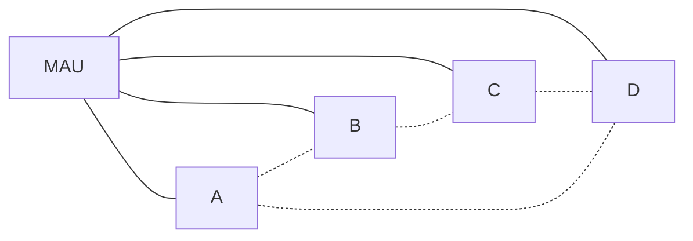

### Working principle

1. A free token circulates the logical ring. Only the device holding the token may transmit, so access is deterministic. *(packet path: A → B → C → D → A)*
2. A wants to send to C. It captures the token and appends its data to it, forming a frame.
3. A sends the frame to its downstream neighbour. B is not the destination, so it simply retransmits it. *(packet path: A → MAU → B → MAU → C)*
4. C is the destination: it copies the data, marks the frame as read and passes it on. *(packet path: C → MAU → D → MAU → A)*
5. The frame returns to A, which sees the read-mark, removes the frame and releases a new free token.
6. If node D fails but the MAU stays up, the MAU wraps that port and passes traffic on without it. *(packet path: A → MAU → B)*
7. If the MAU itself fails, nothing can pass: a single point of failure. FDDI uses dual rings for failover.

### Advantages

- Deterministic: maximum wait time is predictable
- Can serve as a network backbone
- Orderly access, no collisions

### Disadvantages

- Simple ring has a single point of failure
- Legacy tech, almost entirely replaced by Ethernet
- MAU is a central dependency

### Where it is deployed

- Commercial: legacy IBM LANs in banks and offices; FDDI backbones in campuses
- Defense/industrial: deterministic timing in older control and factory networks
- Other: dual-ring fibre rings (FDDI, SONET-style rings) in telecom metro networks

### Terms

| Term | Full form / meaning |
|---|---|
| IEEE 802.5 | Institute of Electrical and Electronics Engineers standard for token ring |
| MAU | Media Access Unit, hub that connects ring nodes |
| FDDI | Fiber Distributed Data Interface, dual-ring fibre standard |
| LAN | Local Area Network |
| CIANA+PS | Confidentiality, Integrity, Availability, Nonrepudiation, Authentication + Privacy, Safety |

---

## Bus

*Topologies.* One backbone cable; every node taps into it and samples the signals that flow by.

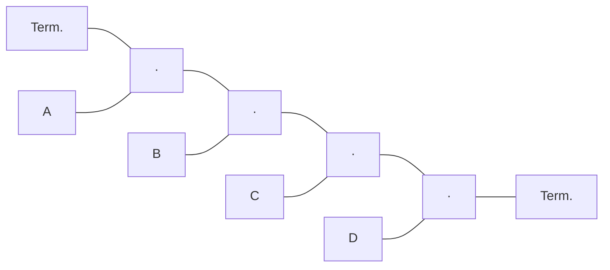

### Working principle

1. A transmits onto the backbone. The signal travels both up and down the cable. *(packet path: A → bus → Term. ; A → bus → bus → bus → bus → Term.)*
2. B, C and D each sample the passing signal. Only D, the addressee, accepts it; the others ignore it.
3. Node C is powered down. Because signals do not pass through nodes, A to D traffic is unaffected. *(packet path: A → bus → bus → bus → bus → D)*
4. Terminators at each end absorb the signal so it does not reflect back along the cable.
5. The backbone cable or backplane is the single point of failure: a break stops the whole bus.

### Advantages

- Adding a node is easy
- A node failure rarely affects the rest
- Some buses allow hot-swap

### Disadvantages

- Cable/backplane failure disables the whole network
- Shared medium: contention and limited length
- Harder to isolate faults

### Where it is deployed

- Commercial: early Ethernet (10BASE2/5), PCI-style backplanes
- Defense: MIL-STD-1553 avionics data bus on military aircraft
- Other: CAN bus in cars, Modbus/Profibus in factories

### Terms

| Term | Full form / meaning |
|---|---|
| Backbone | Main shared cable of the bus |
| SPOF | Single Point of Failure |
| CAN | Controller Area Network |

---

## Star / Tree

*Topologies.* Every device connects to a central switch; switches can connect to other switches to form a tree.

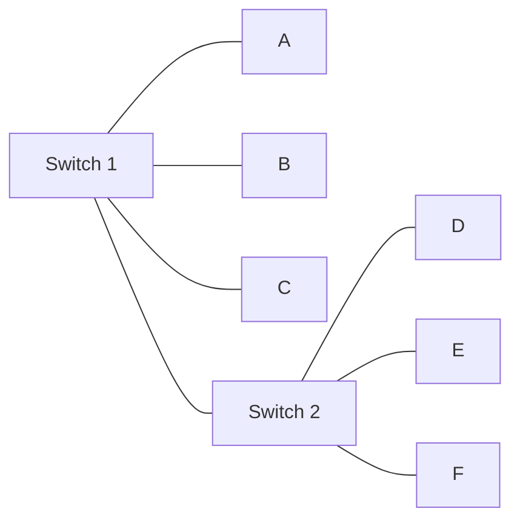

### Working principle

1. A sends a frame. The switch learns which port each device is on and does not flood every device. *(packet path: A → Switch 1 → B)*
2. The switch passes data directly between the two ports only. Other nodes never see it.
3. Switches link to other switches (a tree). A reaches E via both switches. *(packet path: A → Switch 1 → Switch 2 → E)*
4. Adding or removing a node only touches its own cable, which makes deployment simple.
5. If a switch fails, everything attached to it is cut off unless it is redundant.

### Advantages

- Fewer cables than full or partial mesh
- Easy to deploy; nodes added/removed easily
- Fault in one cable affects one node

### Disadvantages

- Central switch is a single point of failure if not redundant
- Cable length to the centre
- Switch capacity limits scale

### Where it is deployed

- Commercial: virtually all office and home Ethernet LANs
- Defense: shipboard and base LANs with redundant core switches
- Other: hospitals, campuses, data centre top-of-rack designs

### Terms

| Term | Full form / meaning |
|---|---|
| Switch | Layer 2 device forwarding frames between specific ports |
| Tree | Hierarchy of stars joined by switches |

---

## Mesh

*Topologies.* Each device connects to several others, giving redundancy and high availability.

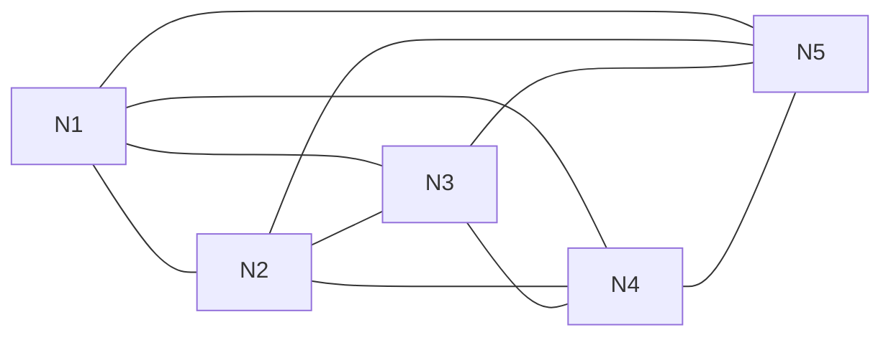

### Working principle

1. N1 sends to N3 over the direct link. *(packet path: N1 → N3)*
2. N2 fails. The network still has many other routes.
3. Traffic reroutes automatically through other nodes (N1, N5, N4, N3). No single point of failure. *(packet path: N1 → N5 → N4 → N3)*
4. Cost: a full mesh of N nodes needs N(N-1)/2 links. 5 nodes need 10; 10 nodes need 45.
5. Wireless networks (airport Wi-Fi, mobile phone systems) behave as meshes with overlapping coverage.

### Advantages

- High level of redundancy and availability
- No single point of failure
- Scales well in wireless form

### Disadvantages

- Very expensive: N(N-1)/2 cables for a full mesh
- Complex to configure and manage

### Where it is deployed

- Commercial: data-centre and storage fabrics, airport Wi-Fi, carrier backbones
- Defense: tactical mobile ad hoc networks (MANET), resilient command networks
- Other: smart cities, disaster-relief and IoT mesh (Zigbee, Thread)

### Terms

| Term | Full form / meaning |
|---|---|
| Full mesh | Every node linked to every other: N(N-1)/2 |
| MANET | Mobile Ad Hoc Network |
| Redundancy | Spare paths or devices that avoid a single point of failure |

---

## Wi-Fi (WLAN, IEEE 802.11)

*Wireless.* Devices connect by radio to a wireless access point that bridges to the wired network.

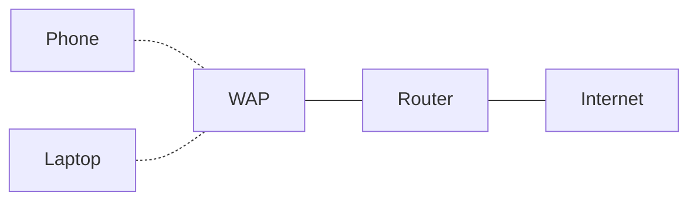

### Working principle

1. The laptop finds the access point and associates with the network name (SSID). *(packet path: Laptop → WAP)*
2. It authenticates (e.g. WPA2/WPA3) and encryption keys are set up, because radio can be monitored. *(packet path: WAP → Laptop)*
3. Data goes by radio to the WAP, which forwards it onto the wired LAN to the router. *(packet path: Laptop → WAP → Router → Internet)*
4. Replies return the same way. Older devices still connect through backwards compatibility, but only the newest standard (802.11ax) gives top speeds. *(packet path: Internet → Router → WAP → Phone)*
5. Risks: eavesdropping and radio interference (denial of service). Range extenders cover bigger sites.

### Advantages

- Mobility and easy deployment
- Backwards compatible
- No cabling to each device

### Disadvantages

- Monitoring and interference risks
- Limited range
- Speed requires latest hardware on both ends

### Where it is deployed

- Commercial: offices, retail, hospitality, warehouses
- Defense: base and hangar LANs with hardened WPA enterprise
- Other: homes, healthcare, schools, public hotspots

### Terms

| Term | Full form / meaning |
|---|---|
| WLAN | Wireless Local Area Network |
| WAP | Wireless Access Point |
| SSID | Service Set Identifier |
| WPA | Wi-Fi Protected Access |
| 802.11ax | Wi-Fi 6, latest generation named in the text |

---

## Cellular & 5G (CDMA / GSM)

*Wireless.* Land is divided into cells, each served by a base station. Neighbouring cells use different frequencies.

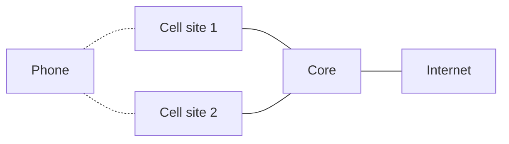

### Working principle

1. The phone locates the strongest cell site. Each cell uses its own set of frequencies to avoid interference with neighbours. *(packet path: Phone → Cell site 1)*
2. The network checks the subscriber: GSM keeps identity on a removable SIM; CDMA uses carrier allow-lists, so the carrier approves phones. *(packet path: Cell site 1 → Core)*
3. Data flows to the core and out to the internet. 5G uses OFDM across wide bandwidth for speed (up to ~20 Gbps) and low latency. *(packet path: Phone → Cell site 1 → Core → Internet)*
4. The user moves. The call hands off to cell site 2 without dropping. *(packet path: Phone → Cell site 2 → Core)*
5. 5G needs many small cells (shorter range) and falls back to 4G where coverage is limited. 5G NR is the radio access technology.

### Advantages

- Wide geographic coverage with mobility
- 5G: high speed, low latency; may replace broadband
- Frequency reuse supports many users

### Disadvantages

- 5G needs many more towers
- Mixed legacy generations complicate BYOD security
- Radio is open to monitoring/jamming

### Where it is deployed

- Commercial: mobile phones, IoT, fixed wireless home internet, smart factories
- Defense: private 5G on bases, tactical comms backhaul
- Other: telemedicine, connected vehicles, remote monitoring

### Terms

| Term | Full form / meaning |
|---|---|
| CDMA | Code-Division Multiple Access |
| GSM | Global System for Mobile communication |
| SIM | Subscriber Identity Module |
| OFDM | Orthogonal Frequency-Division Multiplexing |
| 5G NR | 5G New Radio, access technology from 3GPP |
| 3GPP | 3rd Generation Partnership Project |
| LTE | Long-Term Evolution (4G) |
| RAT | Radio Access Technology |
| BYOD | Bring Your Own Device |

---

## Bluetooth (WPAN, IEEE 802.15)

*Wireless.* Short-range open standard for personal area networks.

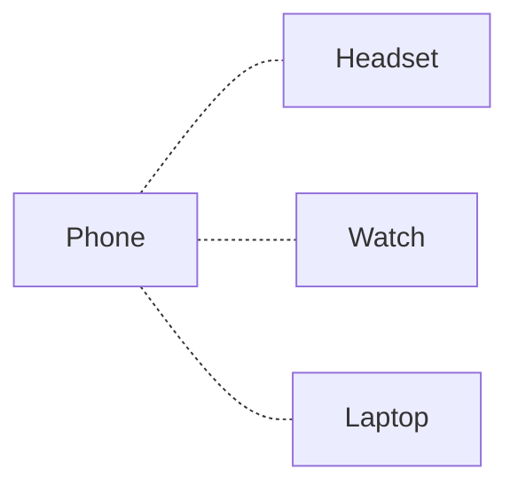

### Working principle

1. Devices discover each other and pair within a few metres. *(packet path: Phone → Headset)*
2. The phone forms a small personal network with several devices. *(packet path: Phone → Watch ; Phone → Laptop)*
3. Audio and data stream over the short-range radio link. *(packet path: Phone → Headset)*
4. Newer revisions use maximum power only when required, saving battery. Highest speed needs up-to-date equipment at both ends.

### Advantages

- Open standard, built into many devices
- Low power
- Simple pairing

### Disadvantages

- Short range
- Needs modern hardware for top speed
- Pairing/eavesdropping risks if poorly configured

### Where it is deployed

- Commercial: headsets, wearables, car hands-free, POS devices
- Defense: soldier-worn sensors and short-range peripherals
- Other: medical monitors, smart home

### Terms

| Term | Full form / meaning |
|---|---|
| WPAN | Wireless Personal Area Network |
| IEEE 802.15 | Working group standard for Bluetooth |

---

## WiMAX (IEEE 802.16)

*Wireless.* Broadband wireless access over long distances, replaced largely by LTE/5G.

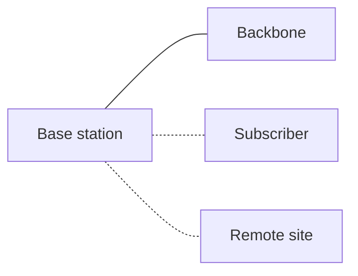

### Working principle

1. A base station covers a wide area with microwave radio.
2. Subscribers connect without laying a cable. Potential over 30 Mbps, typically ~6 Mbps average. *(packet path: Subscriber → Base station)*
3. Traffic is carried to the backbone and internet. *(packet path: Base station → Backbone)*
4. Useful where physical infrastructure is difficult or costly, such as aviation; mostly outside the US. *(packet path: Remote site → Base station)*

### Advantages

- Reaches places without cable
- Cheaper than building physical infrastructure

### Disadvantages

- Slower than wired broadband
- Largely replaced by LTE and 5G

### Where it is deployed

- Commercial: rural broadband outside the US
- Defense: remote site links
- Other: aviation and industrial sites

### Terms

| Term | Full form / meaning |
|---|---|
| WiMAX | Worldwide Interoperability for Microwave Access |
| IEEE 802.16 | Broadband wireless access standard |

---

## Satellite Network

*Wireless.* Broadband delivered via orbiting satellites to remote or sparse areas.

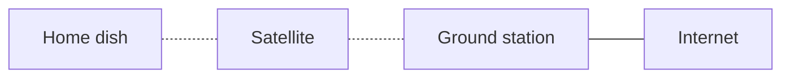

### Working principle

1. The dish needs line of sight to the satellite and sends a request upward. *(packet path: Home dish → Satellite)*
2. The satellite relays it to a ground station connected to the internet. *(packet path: Satellite → Ground station → Internet)*
3. The reply returns the same way. Latency and packet loss are higher than other broadband. *(packet path: Internet → Ground station → Satellite → Home dish)*
4. Extreme weather can degrade or disrupt service.

### Advantages

- Reaches remote/sparse areas
- No local infrastructure

### Disadvantages

- Higher latency and packet loss
- Weather disruption
- Speed depends on package, provider, line of sight

### Where it is deployed

- Commercial: rural ISPs, maritime and airline Wi-Fi
- Defense: SATCOM for command and control, ISR links
- Other: disaster relief, oil and gas, scientific stations

### Terms

| Term | Full form / meaning |
|---|---|
| SATCOM | Satellite Communications |
| Latency | Delay between sending and receiving |
| ISR | Intelligence, Surveillance, Reconnaissance |

---

## Twisted pair (UTP / STP)

*Transmission media.* Insulated copper pairs twisted to reduce electromagnetic interference and crosstalk.

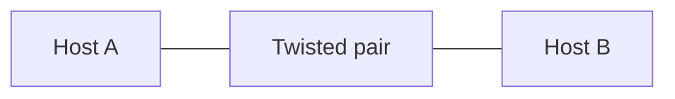

### Working principle

1. Host A sends an electrical signal across a pair of insulated copper legs (A and B legs). *(packet path: Host A → Twisted pair)*
2. The twists make interference hit both legs equally, so it cancels at the receiver. Twist count, insulation and conductor decide quality and cost. *(packet path: Twisted pair → Host B)*
3. UTP has no metal shield, so it picks up interference and can be monitored with the right equipment, but it is cheap and standardised.
4. STP wraps the bundle in a grounded foil shield: better protection from interference and monitoring, but costlier, bulkier, larger bend radius.

### Advantages

- UTP: inexpensive, robust to install, well-defined standards
- STP: better interference and eavesdrop protection

### Disadvantages

- UTP: susceptible to interference and surveillance
- STP: costlier, bulkier, harder to install

### Where it is deployed

- Commercial: office/home Ethernet (UTP most common cable type)
- Defense: STP in sensitive spaces and TEMPEST-conscious rooms
- Other: telephone lines, industrial plants

### Terms

| Term | Full form / meaning |
|---|---|
| UTP | Unshielded Twisted Pair |
| STP | Shielded Twisted Pair |
| EMI | Electromagnetic Interference |
| Crosstalk | Signal leaking between adjacent wires |

---

## Coaxial cable (RG58)

*Transmission media.* One thick conductor, insulation, braided shield and outer sheath.

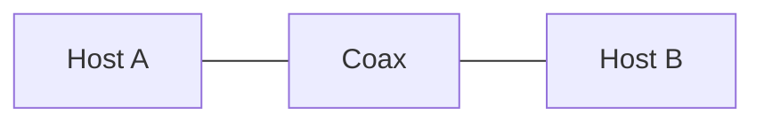

### Working principle

1. The signal travels on the inner conductive core, which is thicker than twisted-pair wire: more bandwidth, longer runs. *(packet path: Host A → Coax)*
2. A dielectric insulator separates the core from the braided grounding shield.
3. The shield blocks outside interference and makes monitoring harder; the sheath protects the cable. *(packet path: Coax → Host B)*
4. Costlier than twisted pair and needs a larger bend radius, but robust for specialised uses like cable TV.

### Advantages

- High bandwidth, long runs
- Good insulation and shielding

### Disadvantages

- More expensive than twisted pair
- Large bend radius, harder to install

### Where it is deployed

- Commercial: cable TV and broadband (DOCSIS)
- Defense: radar and antenna feeds
- Other: CCTV, broadcasting

### Terms

| Term | Full form / meaning |
|---|---|
| Coax | Coaxial cable |
| Dielectric | Insulating layer between core and shield |
| RG58 | A common coaxial cable type |

---

## Fiber optic

*Transmission media.* Light pulses travel through glass or plastic fibre instead of electricity on copper.

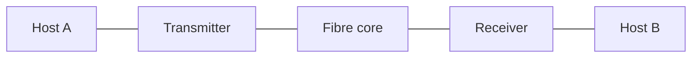

### Working principle

1. The host's electrical signal reaches a transmitter (laser/LED tuned to a light frequency). *(packet path: Host A → Transmitter)*
2. Pulse-code modulation (PCM) turns electrical impulses into light pulses.
3. Light is reflected down the core; cladding keeps it inside, like a mirror-lined cardboard tube, even around bends. *(packet path: Transmitter → Fibre core → Receiver)*
4. The receiver converts light back to electrical signals for Host B. Distance depends on laser strength and glass purity. *(packet path: Receiver → Host B)*

### Advantages

- Very high bandwidth and distance
- Immune to electromagnetic interference
- Hard to tap without detection

### Disadvantages

- Costlier terminations and equipment
- Fragile, needs careful handling

### Where it is deployed

- Commercial: ISP backbones, data centres, FTTH
- Defense: secure backbone links, ship and aircraft networks
- Other: undersea cables, medical endoscopy

### Terms

| Term | Full form / meaning |
|---|---|
| PCM | Pulse-Code Modulation |
| Cladding | Layer that keeps light in the core |
| FTTH | Fibre To The Home |

---

## Software-Defined Network (SDN)

*Architectures.* Network control is separated from hardware and run as software on virtual infrastructure.

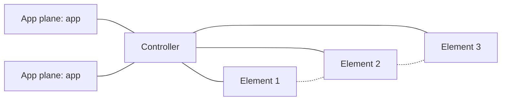

### Working principle

1. An application states what it needs (e.g. a new virtual network) through the Northbound API. *(packet path: App plane: app → Controller)*
2. The controller (control plane) computes routes and policy centrally.
3. Southbound APIs such as OpenFlow push flow rules to the network elements. *(packet path: Controller → Element 1 ; Controller → Element 2 ; Controller → Element 3)*
4. Data plane: packets are forwarded along the programmed path. *(packet path: Element 1 → Element 2 → Element 3)*
5. Status flows back up to the controller and apps. All devices can be configured, tested and security-assessed remotely. *(packet path: Element 2 → Controller → App plane: app)*
6. A new fabric can be defined and tested in minutes, not hours/days; hardware spending can be optimised.

### Advantages

- Fabric created in minutes
- Remote security configuration and assessment
- Hardware abstracted away from services

### Disadvantages

- Controller is a high-value target
- Complexity of virtualisation
- Needs vendor support for OpenFlow

### Where it is deployed

- Commercial: cloud data centres, SD-WAN for branches, telecom NFV
- Defense: rapidly reconfigurable tactical and cyber-range networks
- Other: campus segmentation, research testbeds

### Terms

| Term | Full form / meaning |
|---|---|
| SDN | Software-Defined Network |
| API | Application Programming Interface |
| NBI | Northbound Interface |
| OpenFlow | Vendor-neutral protocol from the Open Networking Foundation |
| A-CPI / D-CPI | Application-/Data-controller Plane Interface |
| VM | Virtual Machine |
| ONF | Open Networking Foundation |

---

## Peer-to-Peer (P2P)

*Architectures.* Equal nodes share resources with each other; no dedicated server.

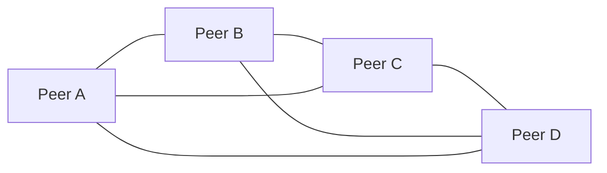

### Working principle

1. Each peer has its own files and shares them on equal footing. *(packet path: Peer A → Peer B ; Peer B → Peer A)*
2. A needs a file and must find who has it, which costs time as peers grow. *(packet path: Peer A → Peer B ; Peer A → Peer C ; Peer A → Peer D)*
3. It is fetched directly from the peer that holds it. Often faster locally. *(packet path: Peer D → Peer A)*
4. If one peer drops, the rest continue: no server to fail.

### Advantages

- No server single point of failure
- Easy and cheap to set up
- Fast locally

### Disadvantages

- Unmanageable as resources grow
- Hard to locate resources
- Weak central control and security policy

### Where it is deployed

- Commercial: SOHO file sharing, content delivery assist
- Defense: ad hoc field-team sharing
- Other: BitTorrent, blockchain networks

### Terms

| Term | Full form / meaning |
|---|---|
| P2P | Peer-to-Peer |
| SOHO | Small Office / Home Office |

---

## Client-Server

*Architectures.* A server provides services to clients, such as print, DHCP and DNS.

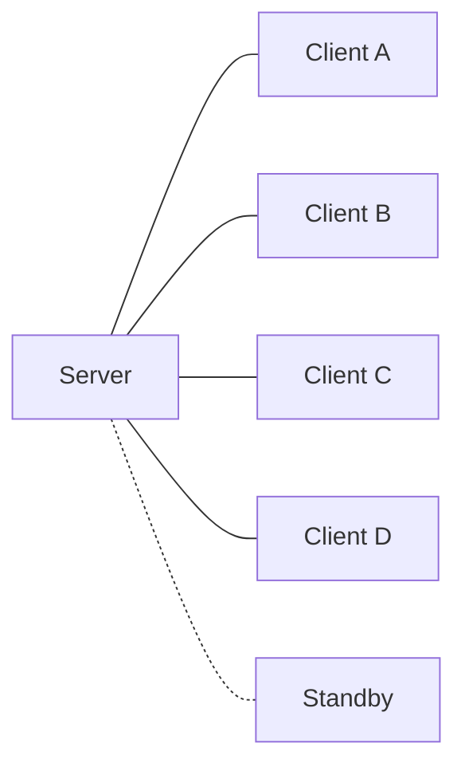

### Working principle

1. Client A requests a service (e.g. print a file). *(packet path: Client A → Server)*
2. The server authenticates the request, accepts and stores the file.
3. It queues the job, prints in turn, deletes the local copy and replies. *(packet path: Server → Client A)*
4. It serves many clients at once. *(packet path: Server → Client B ; Server → Client C ; Server → Client D)*
5. The server is a central point of failure; redundant servers keep availability. *(packet path: Server → Standby)*

### Advantages

- Central control and security
- Servers sized for many clients
- Easier management

### Disadvantages

- Server is a single point of failure
- Costlier; needs redundancy for availability

### Where it is deployed

- Commercial: web, email, databases, print, DHCP, DNS
- Defense: classified enclaves with controlled servers
- Other: banking, e-government, cloud

### Terms

| Term | Full form / meaning |
|---|---|
| DHCP | Dynamic Host Configuration Protocol |
| DNS | Domain Name System |
| NFC | Near-Field Communication |

---

## Tunneling, VPN & Split tunneling

*Tunneling & Web.* Encapsulating one protocol inside another to cross a network.

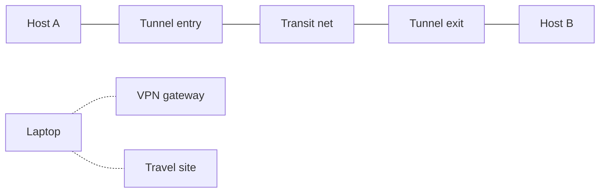

### Working principle

1. Host A sends an original (inner) packet, e.g. IPv6, toward Host B. *(packet path: Host A → Tunnel entry)*
2. The entry point encapsulates it: wraps it in an outer packet of the carrying protocol (e.g. IPv4).
3. The transit network sees only the outer packet. 6to4, ISATAP and Teredo (IPv6 inside IPv4 UDP) work like this; HTTPS tunnels data via TLS. *(packet path: Tunnel entry → Transit net → Tunnel exit)*
4. The exit decapsulates and delivers the inner packet to Host B. *(packet path: Tunnel exit → Host B)*
5. Split tunneling: corporate traffic goes through the VPN gateway; internet traffic goes directly out the hotel network. *(packet path: Laptop → VPN gateway ; Laptop → Travel site)*
6. Control at the firewall or proxy; a split-tunnel laptop can bridge networks, so keep on-access antivirus on.

### Advantages

- Lets IPv6 and IPv4 coexist
- Secure remote access (VPN)
- Split tunneling saves VPN bandwidth

### Disadvantages

- Can bypass firewall policy
- Split tunneling exposes the device as a bridge
- Each method has compatibility and security issues

### Where it is deployed

- Commercial: corporate VPNs, HTTPS, VoIP
- Defense: encrypted site-to-site links
- Other: ISPs' IPv6 migration, remote work

### Terms

| Term | Full form / meaning |
|---|---|
| VPN | Virtual Private Network |
| HTTPS | HTTP over TLS |
| SSL/TLS | Secure Sockets Layer / Transport Layer Security |
| VoIP | Voice over IP |
| 6to4 | IPv6 over IPv4; needs public IPv4 at both ends |
| ISATAP | Intra-Site Automatic Tunnel Addressing Protocol |
| Teredo | IPv6 inside IPv4 UDP |
| UDP | User Datagram Protocol |

---

## Proxy, Tor, Surface/Deep/Dark web

*Tunneling & Web.* Three layers of the web, like an iceberg, plus proxy and onion routing.

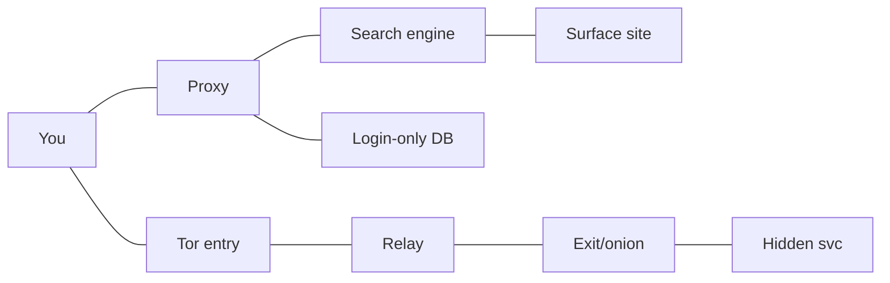

### Working principle

1. Proxy: it requests content for you, hiding your address and letting policy be applied. *(packet path: You → Proxy)*
2. Surface web (~4% by some estimates): public, indexed by search engines, legal content. *(packet path: Proxy → Search engine → Surface site)*
3. Deep web (~80%): private data like medical, bank, school and email records; requires login and is not indexed. *(packet path: Proxy → Login-only DB)*
4. Dark web: hidden content reached with special tools. Tor wraps data in layers sent via entry, relay and exit nodes. *(packet path: You → Tor entry → Relay → Exit/onion → Hidden svc)*
5. Viewing is legal in most countries, but analysts and law enforcement watch it.

### Advantages

- Proxy: anonymity, filtering and caching
- Tor: privacy for journalists and dissidents
- Deep web protects personal data

### Disadvantages

- Dark web hosts crime
- Tor is slow; exit nodes can be watched
- Size estimates are debated

### Where it is deployed

- Commercial: web proxies, caching, content filters; threat intel monitors
- Defense: OSINT and threat hunting on the dark web
- Other: law enforcement, whistleblowing, private research

### Terms

| Term | Full form / meaning |
|---|---|
| Tor | The Onion Router |
| GDPR | General Data Protection Regulation |
| OSINT | Open-Source Intelligence |
| Proxy | Server that makes requests on your behalf |

---

## Glossary

| Term | Full form / meaning |
|---|---|
| 3GPP | 3rd Generation Partnership Project |
| 5G NR | 5G New Radio, access technology from 3GPP |
| 6to4 | IPv6 over IPv4; needs public IPv4 at both ends |
| 802.11ax | Wi-Fi 6, latest generation named in the text |
| A-CPI / D-CPI | Application-/Data-controller Plane Interface |
| API | Application Programming Interface |
| Backbone | Main shared cable of the bus |
| BYOD | Bring Your Own Device |
| CAN | Controller Area Network |
| CDMA | Code-Division Multiple Access |
| CIANA+PS | Confidentiality, Integrity, Availability, Nonrepudiation, Authentication + Privacy, Safety |
| Cladding | Layer that keeps light in the core |
| Coax | Coaxial cable |
| Crosstalk | Signal leaking between adjacent wires |
| DHCP | Dynamic Host Configuration Protocol |
| Dielectric | Insulating layer between core and shield |
| DNS | Domain Name System |
| EMI | Electromagnetic Interference |
| FDDI | Fiber Distributed Data Interface, dual-ring fibre standard |
| FTTH | Fibre To The Home |
| Full mesh | Every node linked to every other: N(N-1)/2 |
| GDPR | General Data Protection Regulation |
| GSM | Global System for Mobile communication |
| HTTPS | HTTP over TLS |
| IEEE 802.15 | Working group standard for Bluetooth |
| IEEE 802.16 | Broadband wireless access standard |
| IEEE 802.5 | Institute of Electrical and Electronics Engineers standard for token ring |
| ISATAP | Intra-Site Automatic Tunnel Addressing Protocol |
| ISR | Intelligence, Surveillance, Reconnaissance |
| LAN | Local Area Network |
| Latency | Delay between sending and receiving |
| LTE | Long-Term Evolution (4G) |
| MANET | Mobile Ad Hoc Network |
| MAU | Media Access Unit, hub that connects ring nodes |
| NBI | Northbound Interface |
| NFC | Near-Field Communication |
| OFDM | Orthogonal Frequency-Division Multiplexing |
| ONF | Open Networking Foundation |
| OpenFlow | Vendor-neutral protocol from the Open Networking Foundation |
| OSINT | Open-Source Intelligence |
| P2P | Peer-to-Peer |
| PCM | Pulse-Code Modulation |
| Proxy | Server that makes requests on your behalf |
| RAT | Radio Access Technology |
| Redundancy | Spare paths or devices that avoid a single point of failure |
| RG58 | A common coaxial cable type |
| SATCOM | Satellite Communications |
| SDN | Software-Defined Network |
| SIM | Subscriber Identity Module |
| SOHO | Small Office / Home Office |
| SPOF | Single Point of Failure |
| SSID | Service Set Identifier |
| SSL/TLS | Secure Sockets Layer / Transport Layer Security |
| STP | Shielded Twisted Pair |
| Switch | Layer 2 device forwarding frames between specific ports |
| Teredo | IPv6 inside IPv4 UDP |
| Tor | The Onion Router |
| Tree | Hierarchy of stars joined by switches |
| UDP | User Datagram Protocol |
| UTP | Unshielded Twisted Pair |
| VM | Virtual Machine |
| VoIP | Voice over IP |
| VPN | Virtual Private Network |
| WAP | Wireless Access Point |
| WiMAX | Worldwide Interoperability for Microwave Access |
| WLAN | Wireless Local Area Network |
| WPA | Wi-Fi Protected Access |
| WPAN | Wireless Personal Area Network |
